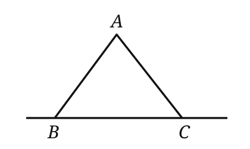

# 《综合3》B卷｜错题原题转写

首次批改：2026-11-20。复核：2026-11-26。题号沿用原卷。第23（1）保留为同一题组的铺垫。第22题配图为原始三角形与直线的示意重绘，供作图，作答笔迹未收录。

## 19. 计算：

（1）$(xy^{-1}-x^{-1}y)\div(x^{-1}-y^{-1})$

（3）$\dfrac{a^2+4ab+4b^2}{a-b}\div\left(\dfrac{3b^2}{a-b}-a-b\right)$

## 21

在福州地铁6号线某段工程建设中，甲队单独完成这项工程需要150天，甲队单独施工30天后增加乙队，两队又共同工作了15天，共完成总工程的 $\dfrac13$。

（1）求乙队单独完成这项工程需要多少天？

（2）为了加快工程进度，甲、乙两队各自提高工作效率，提高后甲队的工作效率是乙队工作效率的 $m$ 倍，若两队合作40天完成剩余的工程，求乙队提高后的工作效率是提高前工作效率的几倍（用含 $m$ 的式子表示）。

## 22

如图，已知 $\triangle ABC$，将 $\triangle ABC$ 沿直线 $BC$ 平移得到 $\triangle A_1B_1C_1$（其中 $A、B、C$ 分别与 $A_1、B_1、C_1$ 对应），平移的距离为 $BC$ 长度的 $\dfrac23$。

（1）画出满足条件的 $\triangle A_1B_1C_1$；

（2）连接 $AC_1$，如果 $\triangle ABC$ 的面积为 $\dfrac92$，求出 $\triangle ABC_1$ 的面积。

## 23. 观察下列算式：

第一个式子 $\dfrac1{x(x+1)}=\left(\dfrac1x-\dfrac1{x+1}\right)\times1$；
第二个式子 $\dfrac1{x(x+2)}=\left(\dfrac1x-\dfrac1{x+2}\right)\times\dfrac12$；

第三个式子 $\dfrac1{x(x+3)}=\left(\dfrac1x-\dfrac1{x+3}\right)\times\dfrac13$；
第四个式子 $\dfrac1{x(x+4)}=\left(\dfrac1x-\dfrac1{x+4}\right)\times\dfrac14$；……

根据你发现的规律解决下列问题：

（1）写出第 $n$ 个式子：________________（$n$ 为正整数）。

（2）$\dfrac1{(x+m)(x+n)}=$ ________________（$m$ 为正整数且 $m\ne n$）。

（3）若 $|b-3|+(a-2)^2=0$，试求
$$
\dfrac1{(a+1)(b+1)}+\dfrac1{(a+2)(b+2)}+\cdots+\dfrac1{(a+100)(b+100)}
$$
的值。
