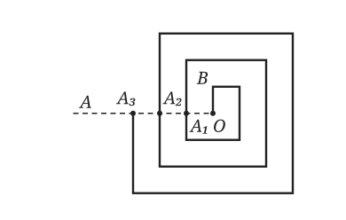
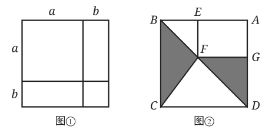

# 《综合 2》原题转写

- 来源：原卷第1、2、4页（共4页）。第3页由家长确认无错。试卷日期未提供。
- 本页保留原卷题号，第6题、第28题配图为依据原卷的清洁重绘。第28题保留全题以保留共用材料。

### 第6题（第1页）

6．如图是一回形图，其回形通道的宽和 $OB$ 的长均为1，回形线与射线 $OA$ 交于 $A_1、A_2、A_3$。若从 $O$ 点到 $A_1$ 点的回形线为第1圈（长为7），从 $A_1$ 点到 $A_2$ 点的回形线为第2圈，……，依此类推，则第24圈的长为（　　）

A．191　　B．184　　C．185　　D．179

### 第13题（第1页）

13．若 $x=\dfrac{1-a}{1+a}$，$y=\dfrac{4-3a}{3-4a}$，则用含 $x$ 的代数式表示 $y$ 为 ______。

### 第16题（第2页）

16．一项工作由甲单独做，需 $a$ 天完成；如果由甲、乙两人合作，则可提前2天完成，则乙单独完成该项工作需要的天数为 ______ 天。

### 第18题（第2页）

18．已知有理数 $a、b、c$ 满足 $(2a^2+8a+11)(b^2-10b+29)(3c^2-18c+32)\le 60$，那么 $a+b+c$ 的值为 ______。

### 第21题第（1）问（第2页）

21．解方程：（1）$\dfrac{x+2}{x-2}-\dfrac{16}{x^2-4}=\dfrac{1}{x+2}$；

### 第28题（第4页）

28．阅读理解：我国著名数学家华罗庚曾说：“数缺形时少直观，形缺数时难入微，数形结合百般好，隔裂分家万事休。”数形结合是解决数学问题的重要思想方法，通过计算几何图形的面积可以验证一些代数恒等式。

（1）如图①是一个大正方形被分割成了边长分别为 $a$ 和 $b$ 的两个正方形，长宽分别为 $a$ 和 $b$ 的两个长方形，利用这个图形可以验证公式 ______。

利用上述公式解决下列问题：

【直接应用】（2）若 $xy=2$，$x+y=7$，则 $x^2+y^2=$ ______；

【类比应用】（3）若 $(20-x)(x-30)=10$，求 $(20-x)^2+(x-30)^2$ 的值；

【知识迁移】（4）将两个正方形 $ABCD$，$EFGA$ 如图，摆放，若两个正方形面积之和为65，$BE=3$，求图中阴影部分面积和。

### 第29题（第4页）

29．设三角形三边长为 $a、b、c$，且三边长满足方程组
$$
\begin{cases}
2ab+c^2-a=91,\\
2bc-a^2+b=24,\\
2ac-b^2-c=61,
\end{cases}
$$
试求 $a+b-c$ 的值。
