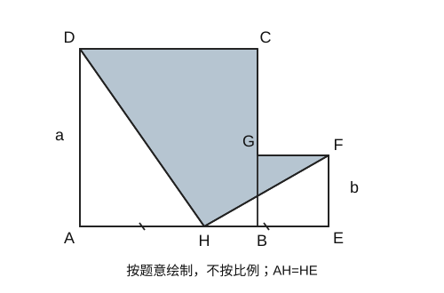

# 本学期数学错题巩固练习（学生版）

> 满分100分，建议用时90分钟（作答85分钟，检查5分钟）；共20道大题。
> 本学期统计区间：2026-09-01至2026-10-17；实际有逐题记录的区间为09-23至10-16。
> 基于已归档错题编制，覆盖整式运算、乘法公式、因式分解及相关综合应用；不代表学校完整考试范围。

姓名：__________  日期：__________  实际用时：__________  得分：__________

说明：独立完成，不查答案，不用计算器。计算题与解答题写必要过程；含除式的题均在原式有意义的取值范围内作答。

## 一、选择题（6题，每题2分，共12分；建议8分钟）

### 1.（2分）

下列计算正确的是（    ）。
A. a²·a⁵=a¹⁰    B. (a²)⁵=a⁷
C. (-2a²)³=-8a⁶    D. (a-b)²=a²-b²

### 2.（2分）

单项式 -5πx²y 的系数和次数分别是（    ）。
A. -5，3    B. -5π，3    C. -5π，2    D. -5，2

### 3.（2分）

若 (5-2t)⁰=1，则 t 应满足（    ）。
A. t≠0    B. t=5/2    C. t为任意实数    D. t≠5/2

### 4.（2分）

(-u-2v)² 等于（    ）。
A. u²+4uv+4v²    B. u²-4uv+4v²
C. u²+2uv+4v²    D. -u²-4uv-4v²

### 5.（2分）

若 x²+2(k-1)x+16 是完全平方式，则 k 的值为（    ）。
A. 5    B. -3    C. 5或-3    D. 3或-5

### 6.（2分）

已知 2ᵖ=3，2ᑫ=12，2ʳ=18，下列关系正确的是（    ）。
A. p+q=r    B. p+q=r+1    C. 2p+q=r    D. p+2q=2r

## 二、填空题（6题，每题3分，共18分；建议12分钟）

### 7.（3分）

已知 (a+b)²=81，(a-b)²=25，则 a²+b²=________，ab=________。

### 8.（3分）

在横线上填入整式：18x⁵y⁴ ÷ (________) = -3x²y。

### 9.（3分）

计算 (6.3×10⁹) ÷ (9×10⁴)，结果用科学记数法表示：________。

### 10.（3分）

已知 x²+4x=3，则 2x²+8x-5 的值为________。

### 11.（3分）

已知 a、b>0，且 3a=2b，则 a:b=________。

### 12.（3分）

多项式 P(x)=(x²+2x-1)(2x²-x+1)² 展开后，各项系数之和为________。

## 三、计算题（共28分；建议22分钟）

### 13.（12分）

计算（每小题3分）：

(1) (m²)³·(-2m)³·(-m)

答：

(2) (x+y)³·(y-x)⁴·(x-y)²（用幂的形式表示）

答：

(3) [-(-2a²)²]³

答：

(4) (1/4)²⁰²⁶ × (-16)¹⁰¹³

答：

### 14.（8分）

计算（每小题4分；各除式均非零）：

(1) [3x⁴y³-6x³y²+(3/4)x²y³] ÷ [-(3/2)x²y]

答：

(2) [(2/3)a³b²]² ÷ [-(4/9)a²b]

答：

### 15.（8分）

计算（每小题4分）：

(1) (3x-y+2)(3x+y-2)

答：

(2) (x²+2x-1)(x²-2x+1)

答：

## 四、因式分解（共12分；建议12分钟）

### 16.（12分）

因式分解（每小题3分，结果应分解到不能再分解为止）：

(1) x²+3xy-10y²

答：

(2) 6ab(a-b)²+9a²b(a-b)

答：

(3) t³(t-2)-8t(t-2)²

答：

(4) 9u²-12uv+4v²

答：

## 五、解答与综合（共30分；建议31分钟）

### 17.（8分）

甲、乙计算同一乘式 (x+a)(2x+b)。甲抄错了 a 的符号，算得 2x²-8x+6；乙漏抄了第二个多项式中 x 的系数，算得 x²+x-6。两人按各自抄写的式子计算均无误。

(1) 求 a、b。（4分）

答：

(2) 写出原乘式的正确展开结果。（4分）

答：

### 18.（8分）

按要求求值：

(1) 已知 s²-s-4=0，求 (4-s)(s+3) 的值。（4分）

答：

(2) 已知 (2032-z)(z-2027)+14=0，求 4059-2z 的值，不必先求出 z。（4分）

答：

### 19.（8分）

如图，正方形 ABCD 与正方形 BEFG 位于直线 AE 的同一侧，A、B、E 依次在同一直线上，边长分别为 a、b（a>b>0）。H 是 AE 的中点，连接 DH、FH。灰色区域是两个正方形内除去白色三角形 ADH、HEF 后的剩余部分。已知 a+b=14，(a-b)²=36。

*按题意绘制，不按比例。白色区域为△ADH和△HEF，其余为灰色。*

(1) 求 a²+b²。（3分）

答：

(2) 求灰色区域的面积。（5分）

答：

### 20.（6分）

设 P=(5²+1)(5⁴+1)(5⁸+1)。把 24P+1 写成 5 的一个幂，并写出变形过程；说明为什么若只求 P，不能直接把它写成 5¹⁶-1。

答：

---

实际作答与复测状态：**待完成／待复测**。本卷尚未收到孩子作答，不据此更新原错题为“已掌握”。
