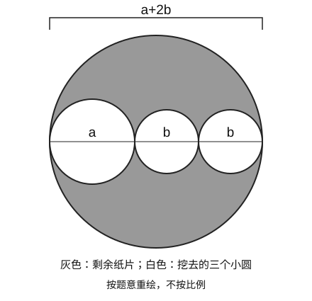

# 2026-10-11 数学作业批改合并归档

> 合并日期：2026-10-17。经用户明确授权，保留同一天两批不同作业的全部原始解析，不用一方覆盖另一方。
> 来源组A：远端19张照片、22条确认错题；来源组B：本地12张照片、27条确认错题，合计49条曾判错记录。
> 两批页码和题号可能重复，必须连同来源组识别。未作答与存疑仍按各组原记录分别保留，不能把题干不全等情况默认为错误。
> 下方保留的提交、邮件和子代理核查说明为各次处理的历史状态；本次合并并未重新批改或实际复测，不把合并计作新的出错事件。10月17日任务的真实保存/上传状态以当次交付为准。

## 来源组A：远端19张照片（原记录完整保留）

## 2026-10-11 数学错题解析

> 批改日期：2026-10-11｜学科：数学｜年级/教材：七年级·华师大版第10章《整式的加减》（含第5周乘法公式、第7周整式的除法、单元练习十一）
> 二次核查：分两批调用项目级子代理「试卷错题二次批阅」核查初判错题（第一批11道、第二批13道）；第二批1道撤题（B4 誤讀上标）、1道降级为存疑（B1 蓝笔归属不明）。主代理已结合原图复核全部异议并定夺（见文末记录）。

### 当日概览

- 检查作业：19 份照片（约 130 题，含小问按小题口径计；分两批批改）
- 确认错题：**22 道**（第一批 11 道＋第二批 11 道，见下）
- 存疑题：**3 道**（E·17 题干截断；I·23 疑似题目印刷问题；K·23 蓝笔归属不明，均未计入错题）
- 未作答：4 道（E·17；K·20；M·29(3)；S·29(2)）
- 红笔误判备注：6 处（家长批改痕迹，经独立核对孩子实际答对，见「做得好的题」）
- 撤题：1 道（第二批 B4，主代理误读上标，二次核查纠正，孩子实际答对）

### 来源信息

| 来源 | 内容 | 页码 | 题号范围 |
|---|---|---|---|
| A | 第10章 整式的加减·第一周 整式 合并同类项 | p.1 | 选择 1–6、填空 7–10 |
| B | 同上 | p.2 | 填空 11–20、解答 21–22 |
| C | 同上 | p.3 | 解答 23–26 |
| D | 同上 | p.4 | 解答 27–28 |
| E | 同上练习 | p.5/6 | 17–22（17 题干照片截断） |
| F | 同上 | p.7 | 23–25 |
| G | 同上 | p.8 | 26–27 |
| H | 同上 | p.9 | 28（含 2 小问） |
| I | 整式乘法/幂运算练习 | 页码未提供 | 20–25 |
| J | 第五周 乘法公式(1)(2) | p.23 | 选择 1–6、填空 7–18 |
| K | 乘法公式练习 | p.24 | 填空 19–20、解答 21–23 |
| L | 乘法公式应用 | 页码未提供 | 24–27 |
| M | 乘法公式（纸片拼图） | p.26 | 28–29 |
| N | 第七周 整式的除法 | 页码未提供 | 选择 1–6、填空 7–18 |
| O | 整式的除法练习 | 页码未提供 | 19–24 |
| P | 整式的除法练习 | 页码未提供 | 25–28 |
| Q | 单元练习十一 | p.36 | 选择 1–6、填空 7–12 |
| R | 整式综合练习 | 页码未提供 | 23–26 |
| S | 整式综合练习 | p.39 | 27–29 |

### 逐题解析

#### 错题 1（A·二·7）——单项式系数漏 π

- 题干：单项式 −2πr 的系数是\_\_\_，次数是\_\_\_次。
- 孩子原答案：系数 −2，次数 1。
- 正确答案：系数 **−2π**，次数 1。
- 思路：π 是常数不是变量，−2πr = (−2π)·r，一次单项式。
- 错因：把 π 当成了变量（π 是常数的概念待巩固）；次数 1 答对，说明指数规则掌握。
- 状态：待订正。

#### 错题 2（B·三·22）——同类项指数方程解错＋代入算错

- 题干：已知 3a⁶b^(2−y) 与 −5aˣb³ 的和仍是关于 a、b 的单项式，求代数式 (1/36)x⁴ − (1/18)x²y² + (1/9)y³ 的值。
- 孩子原答案：∵是单项式 ∴x=6, y=3；代入得 36−3+3=36。
- 正确答案：同类项要求指数对应相等：x=6，2−y=3 → **y=−1**；代入得 36 − 2 − 1/9 = **305/9**。
- 错因两处：① b 的指数方程 2−y=3 解成 y=3（移项符号错）；② 即使按 y=3，−(1/18)x²y² = −18 也被算成 −3。
- 状态：待订正。

#### 错题 3（C·24(4)）——3a=5b 用反＋结论不等号写反

- 题干：ax⁵+bx³+3x+c，x=0 时值为 −1（得 c=−1）；x=3 时值为 −1（得 243a+27b=−9）；若 3a=5b，比较 a+b 与 c 的大小。
- 孩子原答案：由 3a=5b 错得 a=3b/5，算出 a=−1/80；结论写成"a+b<c"。
- 正确答案：由 9a+b=−1/3 及 a=5b/3 得 b=−1/48，a=−5/144，a+b=−1/18 > −1=c，故 **a+b>c**。
- 错因两处：① 3a=5b 解成 a=3b/5（关系用反，应为 a=5b/3）；② 最终比较时不等号方向写反（−1/18 > −1）。
- 状态：待订正。

#### 错题 4（E·19）——行列式展开 xy 系数算错

- 题干：定义 |a b; c d| = ad−bc，求 |5  9x−2xy−y+7; 1  (1/2)xy−2y|。
- 孩子原答案：9xy−9x−9y−7。
- 正确答案：**(9/2)xy−9x−9y−7**。
- 思路：5×((1/2)xy−2y) − (9x−2xy−y+7) = (5/2)xy −10y −9x +2xy +y −7。
- 错因：(5/2+2)=9/2 被写成 9，分数加法口算失误。
- 状态：待订正。

#### 错题 5（E·22）——末步有理数加减算错

- 题干：已知 (ax²−2xy+3y²) − (−ax²+bxy+4y²) = 4x²−9xy+cy²，求 2a−(b−3c) 的值。
- 孩子原答案：a=2, b=7, c=−1（正确）；"原式=4−7−3=−8"。
- 正确答案：**−6**。
- 思路：2a−(b−3c) = 2a−b+3c = 4−7+3×(−1) = 4−7−3 = −6。
- 错因：去括号展开 4−7−3 正确，**最后一步 4−7−3=−6 被算成 −8**（二次核查确认黑笔字迹支持此判定；不是符号错误，是纯计算失误）。
- 状态：待订正。

#### 错题 6（F·24(2)）——代入求值 4x² 算错

- 题干：A=x²−xy，B=−(1/3)x²+(2/3)xy，C=x²+xy；(1) 化简 2A−3B+C（孩子得 4x²−3xy，正确）；(2) 当 x=1/2, y=−1 时求值。
- 孩子原答案：3/4+3/2=9/4。
- 正确答案：4×(1/4) − 3×(1/2)×(−1) = 1+3/2 = **5/2**。
- 错因：4x² = 4×(1/4) = 1 被算成 3/4（疑似把系数 4 与分母约分时出错）。
- 状态：待订正。

#### 错题 7（G·27(2)）——面积末步算错＋漏乘单价

- 题干：游乐场长 20、宽 2y；半圆 A 区直径 y；长方形 B 区 5×3x。(1) 面积（孩子对）；(2) x=5, y=20, π=3，铺草坪 500 元/m²，求铺设费用。
- 孩子原答案：草坪 = 20×40 − 400π/8 − 75 = 800−150−75 = **475**（黑笔，圈注），未再乘 500。
- 正确答案：草坪面积 = 800−150−75 = **575** m²；费用 = 575×500 = **287500 元**。
- 错因两处：① 800−150−75=575 被算成 475（末步连减失误）；② 题目问的是"费用"，漏乘单价 500。
- 状态：待订正。

#### 错题 8（H·28(2)）——比例写反

- 题干：6 张 a×b 小长方形放入矩形 ABCD，左上与右下阴影面积差为 S；BC 变化时 S 不变，求 a、b 关系。
- 孩子原答案：推得 a−2b=0（正确），但写成"a:b=1:2"。
- 正确答案：a=2b，即 **a:b=2:1**。
- 错因：a=2b 换算成比时前后项颠倒。
- 状态：待订正。

#### 错题 9（J·一·3）——完全平方公式四项全错判成两项

- 题干：①(2x+y)²=4x²+y²，②(a−3b)²=a²−9b²，③(−x−y)²=x²−2xy+y²，④(x−1/2)²=x²−2x+1/4；错误的运算有几个？
- 孩子原答案：黑笔 A（1 个）；另有一蓝色"B"字迹（归属存疑，疑为批改笔迹，已标注）。
- 正确答案：**D（4 个全错）**。
- 逐项：①漏 4xy，应 4x²+4xy+y²；②漏 −6ab，应 a²−6ab+9b²；③应 x²+2xy+y²（(−x−y)²=(x+y)²）；④一次项系数应为 −1（2·x·(1/2)），应 x²−x+1/4。
- 错因：③④ 的符号与系数细节未逐项验算（待确认：是否把"看着像对的"直接放过）。
- 状态：待订正。

#### 错题 10（J·二·14）——完全平方式漏解

- 题干：x²+2(m−4)x+25 是完全平方式，m=？
- 孩子原答案：9。
- 正确答案：**9 或 −1**。
- 思路：2(m−4) = ±2×5 = ±10 → m−4=±5。
- 错因：只考虑 +10 的情形，漏掉 −10（"完全平方式中间项可正可负"规则未用全）。
- 状态：待订正。

#### 错题 11（J·二·18）——添项法未除以 (4−1)

- 题干：(4+1)(4²+1)(4⁴+1)⋯(4³²+1)+1/3 = ？
- 孩子原答案：4⁶⁴+1/3。
- 正确答案：添 (4−1) 相乘得 (4⁶⁴−1)，原连乘 = (4⁶⁴−1)/3，再加 1/3 得 **4⁶⁴/3**。
- 错因：添了 (4−1)=3 相乘，但忘记同时除以 3。
- 状态：待订正。

### 第二批逐题解析（19:20 新增作业）

#### 错题 12（N·填空10）——同底数幂相除指数相减算错

- 题干：(x−y)⁸÷(y−x)³÷(y−x)² = \_\_\_。
- 孩子原答案：(y−x)²。
- 正确答案：**(y−x)³**。
- 思路：(x−y)⁸=(y−x)⁸（偶次方），指数 8−3−2=3。
- 错因：指数连减算错（待确认：是否把 (x−y)⁸ 当成 (y−x)⁶ 一类口算失误）。
- 状态：待订正。

#### 错题 13（N·填空11）——科学记数法除法少两个 0

- 题干：(3.2×10⁸)÷(4×10³) = \_\_\_。
- 孩子原答案：800。
- 正确答案：**80000**。
- 思路：(3.2÷4)×10⁸⁻³ = 0.8×10⁵ = 80000。
- 错因：10 的幂次换算失误（10⁵=100000，不是 1000）。
- 状态：待订正。

#### 错题 14（O·21）——连除时 b 的指数算错

- 题干：计算 12a⁵b⁶c⁴÷(−3a²b⁵c)÷(2a³b³c³)。
- 孩子原答案：−2a⁰b⁰c⁰ = −2。
- 正确答案：**−2/b²**。
- 思路：12÷(−3)÷2=−2；a⁵⁻²⁻³=a⁰；b⁶⁻⁵⁻³=b⁻²；c⁴⁻¹⁻³=c⁰。
- 错因：b 的指数 6−5−3=−2 被算成 0（连除时只减了一次）。
- 状态：待订正。

#### 错题 15（P·25）——系数相除算错

- 题干：若 xᵐyⁿ÷(1/4)x³y=4x²，求 (1/3)m²n⁵÷(3/5)mn³ 的值。
- 孩子原答案：m=5, n=1（正确）；(1/3)m²n⁵÷(3/5)mn³ = 5mn² = 25。
- 正确答案：**(5/9)mn² = 25/9**。
- 思路：(1/3)÷(3/5) = 5/9；m²⁻¹=m，n⁵⁻³=n²；代入 m=5, n=1。
- 错因：系数 (1/3)÷(3/5)=5/9 被写成 5（分数除法口算错）。
- 状态：待订正。

#### 错题 16（P·27）——多项式乘法漏一次方＋合并同类项错

- 题干：多项式 A 除以 2x²−1，商 3x−1，余 x+2，求 A。
- 孩子原答案：A=(3x−1)(2x²−1)+x+2 = 6x²−5x+1+x+2 = 6x²+6x+3。
- 正确答案：**(3x−1)(2x²−1)=6x³−3x−2x²+1，故 A=6x³−2x²−2x+3**。
- 错因两处：① 把 2x² 看成 2x 展开（漏一次方，得 6x²−5x+1）；② −5x+x 合并成 +6x（应为 −4x）。
- 状态：待订正（蓝笔已有正确订正 6x³−2x²−2x+3）。

#### 错题 17（Q·选择4）——幂的运算找关系选错

- 题干：已知 3ˣ=4，3ʸ=6，3ᶻ=12，x、y、z 关系正确的是（ ）。(A)xy=2z (B)x+y=2z (C)x+2y=2z (D)x+2y=z。
- 孩子原答案：B。
- 正确答案：**C**。
- 思路：3^(x+2y)=3ˣ·(3ʸ)²=4×36=144=12²=3^(2z)，故 x+2y=2z。
- 错因：未用"两边化成同底幂再比指数"的方法硬凑（待确认）。
- 状态：待订正。

#### 错题 18（Q·填空10）——乘除混合指数漏写

- 题干：(−y³)³·y²÷(−y³)² = \_\_\_。
- 孩子原答案：−y。
- 正确答案：**−y⁵**。
- 思路：(−y³)³=−y⁹；−y⁹·y²=−y¹¹；(−y³)²=y⁶；−y¹¹÷y⁶=−y⁵。
- 错因：指数 11−6=5 漏写（只写了 −y）。
- 状态：待订正。

#### 错题 19（M·29(1)）——完全平方式 k 值算错

- 题干：4x²+kx+25 是完全平方式，k=？
- 孩子原答案：±10。
- 正确答案：**±20**。
- 思路：(2x±5)² = 4x²±20x+25，k=±2×2×5=±20。
- 错因：2×2×5=20 误作 10。
- 状态：待订正。

#### 错题 20（S·27(2)）——代入时 a² 写成 18

- 题干：绿化面积 S=a²+3ab+b²（(1)已对）；当 a=3, b=2 时求 S。
- 孩子原答案：S=18+18+4=40。
- 正确答案：**9+18+4=31**。
- 错因：a²=3²=9 被写成 18（与 3ab=18 混淆）。
- 状态：待订正（蓝笔已有正确订正 31）。

#### 错题 21（S·28(1)）——连加减末步算错

- 题干：阴影面积=(a+b)(a+c)−a²−b²−c²；当 a=5, b=3, c=1 时求值。
- 孩子原答案：列式 15+5+3−9−1 后写 =3。
- 正确答案：**13**。
- 错因：15+5+3−9−1=13 误作 3（连加减末步失误）。
- 状态：待订正（蓝笔已有正确订正 13）。

#### 错题 22（S·29(1)）——配方符号笔误

- 题干：x²+2y²−2xy+4y+4=0，求 xy。
- 孩子原答案：(x²−2xy+y²)+(y²+4y+4) 分组正确，但写成 (x+y)²+(y+2)²=0，得 x=2, y=−2, xy=−4。
- 正确答案：**(x−y)²+(y+2)²=0 → x=y=−2，xy=4**。
- 错因：(x²−2xy+y²)=(x−y)² 被笔误写成 (x+y)²；后续 x=2、xy=−4 均为连锁结果（二次核查确认黑笔字迹）。
- 状态：待订正。

### 未作答与存疑题

1. **E·17（未作答）**：题干照片截断（"已知 x²+xy=−2，3xy+y²=−9，那么式子 2…"），无作答可见。标记需补做；待补全题干后再讲解。
2. **I·23（存疑）**：(−1 7/9)¹²·(3/8)¹³÷(−3/2)¹⁴，孩子答案 27/32。按卷面印刷（除数为 (−3/2)¹⁴）计算得 (4/9)¹²·(1/6)，是个极小的数；而 27/32 恰是除数为 (−2/3)¹⁴ 时的"凑 1"标准答案。疑似题目印刷问题（−3/2 与 −2/3 颠倒），**不计入错题**，待与原书核对后再定。孩子的逆用积的乘方思路本身是通的。
3. **K·20（未作答）**：A、B 长方形拼正方形求 B 的面积，横线空着无作答。标记需补做。
4. **K·23（存疑）**：已知 x²+4x−1=0 求 (2x+1)²−(x+2)(x−2)−x(x−4)。黑笔仅有涂掉的正确第一步（x²+4x=1），完整演算"=2x²+8x+1=2+1=3"为蓝笔，归属无法确认（学生自用蓝笔重写 vs 家长笔迹）。数学上 =3 确错、正确为 7（化简应为 2x²+8x+5），但不能确认是孩子的作答，**不计入错题**，待核实。
5. **M·29(3)（未作答）**：a−b=5, a−c=3 求 a²+b²+c²−ab−ac−bc，只写了开头无完整答案。标记需补做（参考答案 19）。
6. **S·29(2)（未作答）**：a²+b²=10a+8b−41，c 为最长边求 c 范围；只列到 (a−5)²+(b−4)²=0，无 c 范围结论。标记需补做（a=5, b=4，c 范围：5≤c<9）。

### 做得好的题

- **整式基本概念全对**：A·1（7 个整式选 D，红笔误判为错，实际正确）、A·3（二次单项式 1 个）、B·13（同类项 nᵐ=−8）、B·14（整体代入=3）、J·15（(1−m)(1−n)=1）、J·16（(a−b)²=9）、J·17（ab=2）。
- **化简求值流程规范**：B·21（合并同类项后代入得 −11/9）、C·23（m=2,n=3 得 9）、F·23（与 x 无关得 m=4,n=2 → −24）、I·21（3x⁷y⁵）、I·22（(a−b)¹¹）、I·24（x=−4,y=−1 → 15）、I·25（x=−2）。
- **数轴与绝对值**：A·5（z−x）、E·18（−3a+c）、D·28(1)(2)(3)（距离 8；P=3 或 9；v₁/v₂=1/2）。
- **红笔误判澄清**（孩子实际答对）：A·1（D）、E·21（化简求值得 −4，红笔小叉误判）、J·13（m=−4，正确）、L·25（x>y，红笔大叉误判；x−y=ad>0）、Q·28(2)②（ab=9/2=9.5，红笔标记存疑）。
- 连续多步推导题（C·24(1)(2)(3)、D·27(1)(3)、G·26）思路完整，值得肯定。
- **第二批做得好的**：K·19（配方得 bᵃ=9）、K·21（5x²−7y²）、K·22（平方差变形）、L·24（a=−5,b=6）、L·26（清洁区面积差 8ab）、L·27（2⁵⁵<7²²）、M·28(1)列式与(2)①（ab=10）、N·选择 1–6 全对、N·填空 7–9/12–16/18、O·19（指数相减得 1）、O·20（新定义运算 −72n）、O·22/O·23（16a³b⁷）、O·24（化简 −3x+y 得 13）、P·26（81 倍）、P·28（4 与 0）、Q·选择 1/2/3/5/6、Q·填空 7/8/9/11/12、R·23–26 全对、S·27(1)、S·28(2)（m−n=0 与边长无关）。
- **二次核查纠正主代理误判**：N·填空17（孩子 x²−4y² 答对，主代理误读上标为 x⁴，已撤题）。

### 概念问答

- 无（当日未提出新的概念疑问；I·23 的印刷疑问已记入存疑）。

### 当日重点

1. **末步计算失误集中**：错题 5（4−7−3=−8）、错题 7（800−150−75=475）、错题 6（4x²=1→3/4）、错题 20（a²=9→18）、错题 21（连加减得 3）——都是"方法全对、最后一步算错"。建议：以后凡是"算出最终数"的步骤，强制回代验算一遍。
2. **符号与方向**：错题 3（不等号写反＋3a=5b 用反）、错题 8（a:b 写反）、错题 22（配方符号笔误）——"方向/符号"错误是今日高频，列入下周复测。
3. **完全平方公式细节**：错题 9（四项全错判两项）、错题 10（漏 −1 解）、错题 19（k=±20 写成 ±10）——乘法公式是本周新内容，需专项巩固。
4. **读题完整性**：错题 7（问费用只算面积）——答完后回读一遍问题。
5. **整式除法指标准则**：错题 12/13/14/18（指数相减、科学记数法、连除）——除法运算"系数除系数、同底数幂指数相减"需慢算。
6. 待订正 22 道、待补做 4 道（E·17、K·20、M·29(3)、S·29(2)）、待核实 3 道（I·23 印刷、K·23 蓝笔归属、Q·28(2)②红笔标记）。

### 二次核查记录

- 主代理首轮批改：2026-10-11，逐题转写黑笔作答并独立求解判定，11 道错题、2 道存疑。
- 子代理「试卷错题二次批阅」：2026-10-11 回传——8 题未发现异议；3 题有异议：
  - 错题 5：异议成立。黑笔"4−7−3=−8"表明去括号展开正确，错因由"漏 c 的负号"修正为"末步 4−7−3=−6 误作 −8"。已采纳。
  - 错题 7：异议成立。黑笔为"=475"（非 575），错因修正为两点：面积末步加减算错＋漏乘单价。已采纳。
  - 错题 9：异议成立。黑笔为 A（蓝色"B"归属存疑，已标注），判错结论不变（正确答案 D）。已采纳。
  - 另接受补充：错题 3 黑笔"a=−1/80"系由 3a=5b 用反为 a=3b/5 所致，错因已补充。
- 最终裁决由主代理结合原图复核后作出；复核过程保留如上，不计为新的出错事件。

### 第二批二次核查记录（19:20 新增作业）

- 主代理首轮批改：2026-10-11，9 份照片约 65 题，初判 13 道错题。
- 子代理「试卷错题二次批阅」：2026-10-11 回传——10 题未发现异议；3 题有异议：
  - **B4（N·填空17）：异议成立，主代理误判，撤题。**黑笔上标经多轮放大确认为"2"（字形与同页"4"明显不同），孩子作答 x²−4y² 与正确答案一致，卷面亦无红笔打叉。主代理误读上标 2→4，特此纠正，不计入错题。
  - B13（S·29(1)）：异议成立，错因修正。黑笔为"(x+y)²+(y+2)²"，错因由"由 x−y=0 得 x=2"修正为"配方符号笔误：(x²−2xy+y²)=(x−y)² 被写成 (x+y)²"；判错结论不变（xy=−4 错，应 4）。已采纳。
  - B1（K·23）：异议成立，转写归属存疑。完整演算"=2x²+8x+1=2+1=3"为蓝笔，无法确认是学生自用蓝笔还是家长笔迹；黑笔仅有涂掉的正确第一步。判错结论（=3 错，应 7）数学上无误，但按"无法确认答案归属则存疑"规则降级为存疑题，不计入错题。已采纳。
  - 另接受补充：B7 黑笔第二步"−5x+1+x"合并成"+6x"还有一处独立的合并错误（应为 −4x），错因已补充。
- 第二批最终：确认错题 11 道（B2/B3/B5/B6/B7/B8/B9/B10/B11/B12/B13），存疑 1 道（B1），撤题 1 道（B4）。
- 最终裁决由主代理结合原图复核后作出；复核过程保留如上，不计为新的出错事件。

## 来源组B：本地12张照片（原记录完整保留）

## 2026-10-11 数学作业批改与错题解析

### 当日概览

- 批改日期：2026-10-11（Asia/Shanghai）；作业日期、练习册名称未提供。
- 来源：同一批练习册照片12张，页码8、9、19、23、27、29、34、35、43、49、53、56；未提供的页不纳入检查。
- 按独立计算小问或填空单元计：已检查127项；正确86项，确认错误27项，未作答／未完成12项，存疑2项，未处理0项。
- 确认错误包含可辨认的原错误与后续改写错误；同一题不重复计数。27项中13项照片内订正正确、待独立复测，14项仍待处理。颜色仅用于区分书写层次，不据此确认书写者或订正日期。
- 本记录评估题目答案与必要过程，不按原有红勾、红叉或卷面分数直接判定；不计算整份作业分数或掌握率。
- 主代理完成首轮批改及原图局部放大复核；指定子代理配置要求glm-5.3-flashx-ioa，但当前工具未注册该项目级代理或模型。按技能失败分支由主代理复核，**子代理二次核查未完成**，没有子代理回传或异议。
- 原始HEIC、转换预览、局部裁图均仅本地保存。记录不收入无关个人信息。

### 来源与完整检查清单

原图均在 `数学/原题/2026/10月1周/`，下表链接只指向本地原题；原图不会提交或上传。题号按页内分区定位；页27印刷重复的（2）以“第3小题”标识；页29页首缺失主编号，以“页首承接计算”标识。

#### 第8页（0073）

- 本地来源：[2026_10_11_19_27_02_IMG_0073.HEIC](../原题/2026/10月1周/2026_10_11_19_27_02_IMG_0073.HEIC)

| 分区与题号 | 可辨认原作答／订正概况 | 核对答案 | 判定 |
| --- | --- | --- | --- |
| 页首计算 2（1） | -x⁹y⁶ | -x⁹y⁶ | 正确 |
| 页首计算 2（2） | 9/16·x²y⁴z² | 9/16·x²y⁴z² | 正确 |
| 页首计算 3（2） | 0 | 0 | 正确 |
| 页首计算 3（4） | 0 | 0 | 正确 |
| 页首计算 3（3） | (x-y)⁹；详见下方解析 | (x+y)²(x-y)⁷ | 确认错误 |
| 页首计算 3（1） | 64m¹²；详见下方解析 | 16m¹² | 确认错误 |
| 知识要点 1 | (ab)ⁿ=aⁿbⁿ | (ab)ⁿ=aⁿbⁿ | 正确 |
| 知识要点 2 | (abc)ⁿ=aⁿbⁿcⁿ | (abc)ⁿ=aⁿbⁿcⁿ | 正确 |
| 即学即练 1 | a⁶b⁶ | a⁶b⁶ | 正确 |
| 即学即练 2 | a¹²b⁶ | a¹²b⁶ | 正确 |
| 即学即练 4 | -8×10⁹ | -8×10⁹ | 正确 |
| 即学即练 5 | -a⁴b⁶ | -a⁴b⁶ | 正确 |
| 即学即练 7 | -(a²b)⁵，等于-a¹⁰b⁵ | -(a²b)⁵，等于-a¹⁰b⁵ | 正确 |
| 即学即练 8 | x⁷ⁿ | x⁷ⁿ | 正确 |
| 即学即练 9① | 4x | 4x | 正确 |
| 即学即练 10 | x²y³ | x²y³ | 正确 |
| 即学即练 3 | -8/27·a（未见上标6）；详见下方解析 | -8/27·a⁶ | 确认错误 |
| 即学即练 6 | -3a¹²；详见下方解析 | -729a¹² | 确认错误 |
| 即学即练 11 | 5/3；蓝笔改为-1；详见下方解析 | a=1 | 确认错误 |
| 即学即练 9② | 系数被涂改重叠，y³可辨认 | 应填2y³ | 存疑 |
| 计算12 （1） | x⁵y⁴ | x⁵y⁴ | 正确 |
| 计算12 （2） | a⁶b¹² | a⁶b¹² | 正确 |
| 计算12 （3） | -x¹⁸y⁹ | -x¹⁸y⁹ | 正确 |

#### 第9页（0074）

- 本地来源：[2026_10_11_19_27_06_IMG_0074.HEIC](../原题/2026/10月1周/2026_10_11_19_27_06_IMG_0074.HEIC)

| 分区与题号 | 可辨认原作答／订正概况 | 核对答案 | 判定 |
| --- | --- | --- | --- |
| 计算12 （4） | 9/16·a⁴b² | 9/16·a⁴b² | 正确 |
| 计算12 （5） | -1/4·x⁴y⁶ | -1/4·x⁴y⁶ | 正确 |
| 计算12 （6） | -1/64·a⁶b¹⁸ | -1/64·a⁶b¹⁸ | 正确 |
| 计算13 （1） | 21b⁶ | 21b⁶ | 正确 |
| 计算13 （4） | -9/4×10²⁷ | -9/4×10²⁷ | 正确 |
| 计算13 （2） | 负系数乘a⁶b⁶（手写系数约为-17，存在重叠）；详见下方解析 | a⁶b⁶ | 确认错误 |
| 计算13 （3） | 黑笔x⁶-7/4·x⁴正确；蓝笔最后写成x⁶-7/4；详见下方解析 | x⁶-7/4·x⁴ | 确认错误 |
| 简便计算14 （1） | 1 | 1 | 正确 |
| 简便计算14 （3） | 1 | 1 | 正确 |
| 简便计算14 （4） | 16 | 16 | 正确 |
| 简便计算14 （2） | x¹⁵；详见下方解析 | -x¹⁵ | 确认错误 |
| 拓展提升 2 | n=3 | n=3 | 正确 |
| 拓展提升 4 | x=4 | x=4 | 正确 |
| 拓展提升 1 | -5；详见下方解析 | -15/4 | 确认错误 |
| 拓展提升 3 | 24⁶；详见下方解析 | 81 | 确认错误 |
| 拓展提升 5 | 先写x=y=1，得到2；详见下方解析 | 1 | 确认错误 |

#### 第19页（0075）

- 本地来源：[2026_10_11_19_27_37_IMG_0075.HEIC](../原题/2026/10月1周/2026_10_11_19_27_37_IMG_0075.HEIC)

| 分区与题号 | 可辨认原作答／订正概况 | 核对答案 | 判定 |
| --- | --- | --- | --- |
| 课堂练习5 （1） | a=-5，b=-2；由2b-3a=11、a+2b=-9联立 | a=-5，b=-2 | 正确 |
| 课堂练习5 （2） | 照片内未见完整作答 | 6x²-19x+10 | 未作答／未完成 |
| 拓展提升 1 | a=-5 | a=-5 | 正确 |
| 拓展提升 2 | (x-y)³=1 | (x-y)³=1 | 正确 |
| 拓展提升 3 | -1.345 | -1.345 | 正确 |
| 拓展提升 4 | 照片内未见完整作答 | 0 | 未作答／未完成 |

#### 第23页（0076）

- 本地来源：[2026_10_11_19_28_06_IMG_0076.HEIC](../原题/2026/10月1周/2026_10_11_19_28_06_IMG_0076.HEIC)

| 分区与题号 | 可辨认原作答／订正概况 | 核对答案 | 判定 |
| --- | --- | --- | --- |
| 课堂练习1 （1） | 4x²-25 | 4x²-25 | 正确 |
| 课堂练习1 （2） | 1-4a² | 1-4a² | 正确 |
| 课堂练习1 （3） | 1/4·x⁴-1/9 | 1/4·x⁴-1/9 | 正确 |
| 课堂练习1 （4） | 4x²-9y² | 4x²-9y² | 正确 |
| 课堂练习1 （7） | 5x²-5y² | 5x²-5y² | 正确 |
| 课堂练习1 （5） | 9-4x²；详见下方解析 | 4x²-9 | 确认错误 |
| 课堂练习1 （6） | 4y²-6xy+9x²；详见下方解析 | 4y²-12xy+9x² | 确认错误 |
| 课堂练习1 （8） | 9a²-b²-4；详见下方解析 | 9a²-b²+4b-4 | 确认错误 |
| 课堂练习2 （2） | 1 | 1 | 正确 |
| 课堂练习2 （1） | -399又77/81；详见下方解析 | 399又77/81 | 确认错误 |

#### 第27页（0077）

- 本地来源：[2026_10_11_19_28_19_IMG_0077.HEIC](../原题/2026/10月1周/2026_10_11_19_28_19_IMG_0077.HEIC)

| 分区与题号 | 可辨认原作答／订正概况 | 核对答案 | 判定 |
| --- | --- | --- | --- |
| 例题 例5 | a²+b²+c²+2ab-2ac-2bc；详见下方解析 | a²+b²+c²+2ab+2ac+2bc | 确认错误 |
| 例后计算 1 | 照片内未见完整作答 | a²+4b²+1+4ab-2a-4b | 未作答／未完成 |
| 课堂练习1 （1） | 照片内未见完整作答 | 不正确；a²+2ab+b² | 未作答／未完成 |
| 课堂练习1 （2） | 照片内未见完整作答 | 不正确；49-14a+a² | 未作答／未完成 |
| 课堂练习1 （3） | 照片内未见完整作答 | 不正确；a²+4ab+4b² | 未作答／未完成 |
| 课堂练习1 （4） | 照片内未见完整作答 | 不正确；a²-4ab+4b² | 未作答／未完成 |
| 课堂练习2 （1） | 4x²+4xy+y² | 4x²+4xy+y² | 正确 |
| 课堂练习2 （3，原书重复印为2） | 1/16·m²-1/3·mn+4/9·n² | 1/16·m²-1/3·mn+4/9·n² | 正确 |
| 课堂练习2 （5） | 16x⁴-72x²+81 | 16x⁴-72x²+81 | 正确 |
| 课堂练习2 （7） | 81m⁴-9/2·m²n²+1/16·n⁴ | 81m⁴-9/2·m²n²+1/16·n⁴ | 正确 |
| 课堂练习2 （2） | a²+2ab-b²；详见下方解析 | a²+2ab+b² | 确认错误 |
| 课堂练习2 （4） | a⁶+4a³b³+4b⁶；详见下方解析 | a⁶-4a³b³+4b⁶ | 确认错误 |
| 课堂练习2 （8） | a⁴-2a²b²+b⁴；详见下方解析 | a⁴+a²b²+b⁴ | 确认错误 |
| 课堂练习2 （6） | 前面的错误尝试已划去；右侧最终答案末尾超出清晰可见范围 | a²+b²+c²+2ab-2ac-2bc | 存疑 |
| 课堂练习4 1 | B | B：非负数 | 正确 |

#### 第29页（0078）

- 本地来源：[2026_10_11_19_28_26_IMG_0078.HEIC](../原题/2026/10月1周/2026_10_11_19_28_26_IMG_0078.HEIC)

| 分区与题号 | 可辨认原作答／订正概况 | 核对答案 | 判定 |
| --- | --- | --- | --- |
| 页首承接计算 （3） | 81a⁴-72a²b²+16b⁴ | 81a⁴-72a²b²+16b⁴ | 正确 |
| 页首承接计算 （4） | a⁴-8a²b²+16b⁴ | a⁴-8a²b²+16b⁴ | 正确 |
| 课堂练习 11 | -3；详见下方解析 | 9 | 确认错误 |
| 课堂练习 12 | -3/4·x²+10y²-9xy；代入x=-2/3、y=-1得11/3 | -3/4·x²+10y²-9xy；代入x=-2/3、y=-1得11/3 | 正确 |
| 拓展提升1 一般式填空 | 在下方补写[(n+1)(n+2)-1]²-1，并展开为n⁴+6n³+11n²+6n | (n+1)(n+2)-1，等价于n²+3n+1 | 正确 |

#### 第34页（0079）

- 本地来源：[2026_10_11_19_28_41_IMG_0079.HEIC](../原题/2026/10月1周/2026_10_11_19_28_41_IMG_0079.HEIC)

| 分区与题号 | 可辨认原作答／订正概况 | 核对答案 | 判定 |
| --- | --- | --- | --- |
| 例题及变式 例9 | a²+b²=17，ab=-4 | a²+b²=17，ab=-4 | 正确 |
| 例题及变式 例9变式 | a²+b²=13，(a-b)²=1 | a²+b²=13，(a-b)²=1 | 正确 |
| 例题及变式 例10 | 1000000 | 1000000 | 正确 |
| 例题及变式 例10后计算 | 1 | 1 | 正确 |
| 例题 例11 | 黑笔末行b²π/4（中间漏交叉项）；详见下方解析 | πab+πb²/2 | 确认错误 |
| 课堂练习 1 | 65 | 65 | 正确 |
| 课堂练习 2 | 1 | 1 | 正确 |

#### 第35页（0080）

- 本地来源：[2026_10_11_19_28_47_IMG_0080.HEIC](../原题/2026/10月1周/2026_10_11_19_28_47_IMG_0080.HEIC)

| 分区与题号 | 可辨认原作答／订正概况 | 核对答案 | 判定 |
| --- | --- | --- | --- |
| 课堂练习 3 | 黑笔-5b+8ab，代入得15又1/3；蓝笔中途18，最后改为-30；详见下方解析 | 3ab-8b²；值为-30 | 确认错误 |
| 课堂练习 4 | a²+b²=37，(a-b)²=25 | a²+b²=37，(a-b)²=25 | 正确 |
| 课堂练习 5 | △CDE面积=7 | △CDE面积=7 | 正确 |
| 拓展提升 （1） | 不可能；AB+4=9m²≥0 | 不可能；AB+4=9m²≥0 | 正确 |
| 拓展提升 （2） | A²-B²=24m，m为整数故可被24整除 | A²-B²=24m，m为整数故可被24整除 | 正确 |

#### 第43页（0081）

- 本地来源：[2026_10_11_19_29_07_IMG_0081.HEIC](../原题/2026/10月1周/2026_10_11_19_29_07_IMG_0081.HEIC)

| 分区与题号 | 可辨认原作答／订正概况 | 核对答案 | 判定 |
| --- | --- | --- | --- |
| 导入1 乘法 | 7x¹¹ | 7x¹¹ | 正确 |
| 导入1 除法 | 照片内未见完整作答 | 5x² | 未作答／未完成 |
| 总结 规则 | 照片内未见完整作答 | 系数相除；同底数字母幂指数相减；只在被除式中出现的字母及其指数保留 | 未作答／未完成 |
| 问题 2 | 照片内未见完整作答 | 500 kg/人 | 未作答／未完成 |
| 例3 （1） | 4x³y | 4x³y | 正确 |
| 例3 （2） | -1/2·a²b³c | -1/2·a²b³c | 正确 |
| 例3 （3） | -3/2·m³n⁴ | -3/2·m³n⁴ | 正确 |
| 练习1 （1） | 5a⁴ | 5a⁴ | 正确 |
| 练习1 （2） | 1/2·a³c | 1/2·a³c | 正确 |
| 练习1 （3） | -2/3·a | -2/3·a | 正确 |
| 练习1 （4） | -9x⁶y | -9x⁶y | 正确 |
| 填空2 （1） | 12a²b³ | 12a²b³ | 正确 |
| 填空2 （2） | -75x²y³ | -75x²y³ | 正确 |
| 填空2 （3） | 25ax³ | 25ax³ | 正确 |
| 填空2 （4） | -8a；详见下方解析 | -8a²b | 确认错误 |
| 填空2 （5） | 4/3·x⁴ⁿ（停在化简式）；详见下方解析 | 48 | 确认错误 |
| 填空2 （6） | -8；详见下方解析 | -16 | 确认错误 |

#### 第53页（0083）

- 本地来源：[2026_10_11_19_29_55_IMG_0083.HEIC](../原题/2026/10月1周/2026_10_11_19_29_55_IMG_0083.HEIC)

| 分区与题号 | 可辨认原作答／订正概况 | 核对答案 | 判定 |
| --- | --- | --- | --- |
| 课堂练习 7 | 0 | 0 | 正确 |
| 拓展提升 （1） | m=2 | m=2 | 正确 |
| 拓展提升 （2） | m=1，n=1 | m=1，n=1 | 正确 |
| 拓展提升 （3） | a=3b | a=3b | 正确 |

#### 第49页（0084）

- 本地来源：[2026_10_11_19_31_11_IMG_0084.HEIC](../原题/2026/10月1周/2026_10_11_19_31_11_IMG_0084.HEIC)

| 分区与题号 | 可辨认原作答／订正概况 | 核对答案 | 判定 |
| --- | --- | --- | --- |
| A组1 （1） | 1 | 1 | 正确 |
| A组1 （2） | a⁴ | a⁴ | 正确 |
| A组1 （3） | a⁷ | a⁷ | 正确 |
| A组1 （4） | 1 | 1 | 正确 |
| A组2 （1） | 2/5 | 2/5 | 正确 |
| A组2 （2） | -32000 | -32000 | 正确 |
| A组2 （3） | x | x | 正确 |
| A组2 （4） | a⁴ | a⁴ | 正确 |
| A组2 （5） | 2/3·a | 2/3·a | 正确 |
| A组2 （7） | 4xy²-1 | 4xy²-1 | 正确 |
| A组2 （6） | -x⁶yz；详见下方解析 | -9x⁶yz | 确认错误 |
| A组2 （8） | -x²y+3/2·xy-5/2·x²y²；详见下方解析 | -x²y+3/2·xy²-5/2·y³ | 确认错误 |
| B组 3 | 照片内未见完整作答 | 7/6 | 未作答／未完成 |
| B组 4 | 照片内未见完整作答 | 14 | 未作答／未完成 |

#### 第56页（0085）

- 本地来源：[2026_10_11_19_32_06_IMG_0085.HEIC](../原题/2026/10月1周/2026_10_11_19_32_06_IMG_0085.HEIC)

| 分区与题号 | 可辨认原作答／订正概况 | 核对答案 | 判定 |
| --- | --- | --- | --- |
| 拓展提升 1 | A：6不可能 | A：6不可能 | 正确 |
| 拓展提升 2 | m=6 | m=6 | 正确 |
| 拓展提升 3（1）图甲 | C | C | 正确 |
| 拓展提升 3（1）图乙 | A | A | 正确 |
| 拓展提升 3（2） | 黑笔A>B，原说明未写差值；蓝笔补出A-B=(a-b)²，并用a≠b说明为正 | A>B；A-B=(a-b)²>0 | 正确 |

### 确认错误逐题解析

以下“已订正”仅表示照片中存在与参考答案一致的后续文字；不视为独立复测通过。没有提供作答日期，状态核对日期统一为2026-10-11。

#### 1. 第8页 · 页首计算 3（3）

- 必要题干：(x+y)²·(x-y)³·(y-x)⁴，结果用幂的形式表示。
- 孩子原答案／改写：(x-y)⁹。
- 正确答案：**(x+y)²(x-y)⁷**。
- 分步思路：(y-x)⁴=[-(x-y)]⁴=(x-y)⁴，故后两项合成(x-y)⁷；第一项底数是x+y，必须保留。
- 知识点与错因规则：只有同底数幂相乘才能把指数相加；x+y与x-y不是同一底数。
- 订正与复测：待订正；未提供独立复测结果。
- 针对性建议：遮住原答案，按上述步骤重做该小问；写出系数和字母幂的变化，再用代入或符号检查验证。

#### 2. 第8页 · 页首计算 3（1）

- 必要题干：(m²)³·(2m)⁴·(-m)²。
- 孩子原答案／改写：64m¹²。
- 正确答案：**16m¹²**。
- 分步思路：(m²)³=m⁶；(2m)⁴=16m⁴；(-m)²=m²；相乘得16m¹²。
- 知识点与错因规则：把2⁴算成64；各字母指数相加的方向正确。
- 订正与复测：照片中订正正确，待独立复测（订正日期、书写者未提供）；未提供独立复测结果。
- 针对性建议：遮住原答案，按上述步骤重做该小问；写出系数和字母幂的变化，再用代入或符号检查验证。

#### 3. 第8页 · 即学即练 3

- 必要题干：(-2/3·a²)³。
- 孩子原答案／改写：-8/27·a（未见上标6）。
- 正确答案：**-8/27·a⁶**。
- 分步思路：(-2/3)³=-8/27；(a²)³=a⁶，再相乘。
- 知识点与错因规则：积的乘方要作用于每一个因数；字母部分漏做乘方。
- 订正与复测：待订正；未提供独立复测结果。
- 针对性建议：遮住原答案，按上述步骤重做该小问；写出系数和字母幂的变化，再用代入或符号检查验证。

#### 4. 第8页 · 即学即练 6

- 必要题干：[-(-a²-a²-a²)²]³。
- 孩子原答案／改写：-3a¹²。
- 正确答案：**-729a¹²**。
- 分步思路：先合并为-3a²，再平方为9a⁴；外面的负号得到-9a⁴；最后立方为-729a¹²。
- 知识点与错因规则：没有逐层处理系数、负号与括号；先从最内层开始。
- 订正与复测：照片中订正正确，待独立复测（订正日期、书写者未提供）；未提供独立复测结果。
- 针对性建议：遮住原答案，按上述步骤重做该小问；写出系数和字母幂的变化，再用代入或符号检查验证。
- 核对说明：蓝笔-729a¹²正确，外层负号不能丢。

#### 5. 第8页 · 即学即练 11

- 必要题干：2^(3-a)×3^(3-a)=6^(a+1)，求a。
- 孩子原答案／改写：5/3；蓝笔改为-1。
- 正确答案：**a=1**。
- 分步思路：左边=(2×3)^(3-a)=6^(3-a)，故3-a=a+1，解得a=1。
- 知识点与错因规则：同指数幂相乘应把底数相乘、指数保留，不能将3-a加两次。
- 订正与复测：仍待订正；未提供独立复测结果。
- 针对性建议：遮住原答案，按上述步骤重做该小问；写出系数和字母幂的变化，再用代入或符号检查验证。
- 核对说明：蓝笔-1仍不满足原式：代入后左边6⁴，右边6⁰。

#### 6. 第9页 · 计算13 （2）

- 必要题干：(-2a²b²)³+(-3a³b³)²。
- 孩子原答案／改写：负系数乘a⁶b⁶（手写系数约为-17，存在重叠）。
- 正确答案：**a⁶b⁶**。
- 分步思路：第一项=-8a⁶b⁶；第二项=+9a⁶b⁶；合并系数-8+9=1。
- 知识点与错因规则：负数的偶次幂为正；先分别算系数，再合并同类项。
- 订正与复测：照片中订正正确，待独立复测（订正日期、书写者未提供）；未提供独立复测结果。
- 针对性建议：遮住原答案，按上述步骤重做该小问；写出系数和字母幂的变化，再用代入或符号检查验证。
- 核对说明：原负系数的具体数字不用于统计，负数结论已足以确认原答案不成立。

#### 7. 第9页 · 计算13 （3）

- 必要题干：(x³)²+1/2·x²·x²-(3/2·x²)²。
- 孩子原答案／改写：黑笔x⁶-7/4·x⁴正确；蓝笔最后写成x⁶-7/4。
- 正确答案：**x⁶-7/4·x⁴**。
- 分步思路：三项依次为x⁶、1/2·x⁴、9/4·x⁴；后两项合并为-7/4·x⁴。
- 知识点与错因规则：原答案无须更改；后续改写漏掉x⁴因子。
- 订正与复测：仍待订正；未提供独立复测结果。
- 针对性建议：遮住原答案，按上述步骤重做该小问；写出系数和字母幂的变化，再用代入或符号检查验证。
- 核对说明：本题只计一次后续改写错误，不能把黑笔原答案说成错误。

#### 8. 第9页 · 简便计算14 （2）

- 必要题干：(3/4·x)⁵×(-4/3·x²)⁵。
- 孩子原答案／改写：x¹⁵。
- 正确答案：**-x¹⁵**。
- 分步思路：合并为[(3/4·x)×(-4/3·x²)]⁵=(-x³)⁵=-x¹⁵。
- 知识点与错因规则：负底数的奇次幂仍为负；先把系数相乘。
- 订正与复测：照片中订正正确，待独立复测（订正日期、书写者未提供）；未提供独立复测结果。
- 针对性建议：遮住原答案，按上述步骤重做该小问；写出系数和字母幂的变化，再用代入或符号检查验证。

#### 9. 第9页 · 拓展提升 1

- 必要题干：-0.4²⁰²¹×(-5/3)²⁰²²×(3/2)²⁰²³。
- 孩子原答案／改写：-5。
- 正确答案：**-15/4**。
- 分步思路：负号留在外面；将三组中共同的2021次幂合并，[(2/5)(5/3)(3/2)]²⁰²¹=1；还剩-(5/3)(3/2)²=-15/4。
- 知识点与错因规则：拆出共同指数后要保留剩余因子；原过程也把3/2误写成3/8。
- 订正与复测：照片中订正正确，待独立复测（订正日期、书写者未提供）；未提供独立复测结果。
- 针对性建议：遮住原答案，按上述步骤重做该小问；写出系数和字母幂的变化，再用代入或符号检查验证。

#### 10. 第9页 · 拓展提升 3

- 必要题干：(16a²)³·(1/8)⁴=9，求a¹²。
- 孩子原答案／改写：24⁶。
- 正确答案：**81**。
- 分步思路：16³=4096，8⁴=4096，系数抵消后a⁶=9；a¹²=(a⁶)²=81。
- 知识点与错因规则：把相乘的a²·a²·a²当成相加，并漏算数字系数的幂。
- 订正与复测：照片中订正正确，待独立复测（订正日期、书写者未提供）；未提供独立复测结果。
- 针对性建议：遮住原答案，按上述步骤重做该小问；写出系数和字母幂的变化，再用代入或符号检查验证。

#### 11. 第9页 · 拓展提升 5

- 必要题干：mˣ=2023，nʸ=2023，mn=2023，求(x+y)/(xy)。
- 孩子原答案／改写：先写x=y=1，得到2。
- 正确答案：**1**。
- 分步思路：(mˣ)ʸ=2023ʸ，(nʸ)ˣ=2023ˣ，相乘得(mn)ˣʸ=2023^(x+y)。代入mn=2023，得xy=x+y，所以商为1。
- 知识点与错因规则：没有依据就指定x、y的值；应利用同底数幂比较指数。
- 订正与复测：照片中订正正确，待独立复测（订正日期、书写者未提供）；未提供独立复测结果。
- 针对性建议：遮住原答案，按上述步骤重做该小问；写出系数和字母幂的变化，再用代入或符号检查验证。
- 核对说明：按教材实数幂的通常有意义条件使用幂法则；原题未另列底数取值范围。

#### 12. 第23页 · 课堂练习1 （5）

- 必要题干：(-3-2x)(3-2x)。
- 孩子原答案／改写：9-4x²。
- 正确答案：**4x²-9**。
- 分步思路：写成(-2x-3)(-2x+3)，平方差得(-2x)²-3²=4x²-9。也可提出负号，得到-(3+2x)(3-2x)。
- 知识点与错因规则：提出整体负号时漏掉负号；最终两项符号颠倒。
- 订正与复测：待订正；未提供独立复测结果。
- 针对性建议：遮住原答案，按上述步骤重做该小问；写出系数和字母幂的变化，再用代入或符号检查验证。

#### 13. 第23页 · 课堂练习1 （6）

- 必要题干：(2y-3x)(2y-3x)。
- 孩子原答案／改写：4y²-6xy+9x²。
- 正确答案：**4y²-12xy+9x²**。
- 分步思路：这是(2y-3x)²；交叉项为-2×2y×3x=-12xy。
- 知识点与错因规则：完全平方的中间项是两因数乘积的2倍，不是只乘一次。
- 订正与复测：待订正；未提供独立复测结果。
- 针对性建议：遮住原答案，按上述步骤重做该小问；写出系数和字母幂的变化，再用代入或符号检查验证。

#### 14. 第23页 · 课堂练习1 （8）

- 必要题干：(3a-b+2)(3a+b-2)。
- 孩子原答案／改写：9a²-b²-4。
- 正确答案：**9a²-b²+4b-4**。
- 分步思路：看成[3a-(b-2)][3a+(b-2)]=9a²-(b-2)²；展开得9a²-b²+4b-4。
- 知识点与错因规则：应把b-2作为一个整体；展开平方时漏了-4b交叉项。
- 订正与复测：照片中订正正确，待独立复测（订正日期、书写者未提供）；未提供独立复测结果。
- 针对性建议：遮住原答案，按上述步骤重做该小问；写出系数和字母幂的变化，再用代入或符号检查验证。

#### 15. 第23页 · 课堂练习2 （1）

- 必要题干：19又7/9×20又2/9。
- 孩子原答案／改写：-399又77/81。
- 正确答案：**399又77/81**。
- 分步思路：19又7/9=20-2/9，20又2/9=20+2/9；积=400-4/81=399又77/81。
- 知识点与错因规则：两因数都是正数，积应为正；本题没有整体负号。
- 订正与复测：待订正；未提供独立复测结果。
- 针对性建议：遮住原答案，按上述步骤重做该小问；写出系数和字母幂的变化，再用代入或符号检查验证。

#### 16. 第27页 · 例题 例5

- 必要题干：展开(a+b+c)²。
- 孩子原答案／改写：a²+b²+c²+2ab-2ac-2bc。
- 正确答案：**a²+b²+c²+2ab+2ac+2bc**。
- 分步思路：先算[(a+b)+c]²=(a+b)²+2(a+b)c+c²，再展开；三个交叉项均为正。
- 知识点与错因规则：把加c误当成减c；符号必须来自题目各项。
- 订正与复测：待订正；未提供独立复测结果。
- 针对性建议：遮住原答案，按上述步骤重做该小问；写出系数和字母幂的变化，再用代入或符号检查验证。

#### 17. 第27页 · 课堂练习2 （2）

- 必要题干：(-a-b)²。
- 孩子原答案／改写：a²+2ab-b²。
- 正确答案：**a²+2ab+b²**。
- 分步思路：(-a-b)²=[-(a+b)]²=(a+b)²=a²+2ab+b²。
- 知识点与错因规则：负号整体平方后为正，b²项不能写成负数。
- 订正与复测：待订正；未提供独立复测结果。
- 针对性建议：遮住原答案，按上述步骤重做该小问；写出系数和字母幂的变化，再用代入或符号检查验证。

#### 18. 第27页 · 课堂练习2 （4）

- 必要题干：(-a³+2b³)²。
- 孩子原答案／改写：a⁶+4a³b³+4b⁶。
- 正确答案：**a⁶-4a³b³+4b⁶**。
- 分步思路：交叉项=2×(-a³)×2b³=-4a³b³，平方项均为正。
- 知识点与错因规则：平方项为正不代表交叉项也为正；两项异号时交叉项为负。
- 订正与复测：待订正；未提供独立复测结果。
- 针对性建议：遮住原答案，按上述步骤重做该小问；写出系数和字母幂的变化，再用代入或符号检查验证。

#### 19. 第27页 · 课堂练习2 （8）

- 必要题干：(a²+ab+b²)(a²-ab+b²)。
- 孩子原答案／改写：a⁴-2a²b²+b⁴。
- 正确答案：**a⁴+a²b²+b⁴**。
- 分步思路：以a²+b²为整体：[(a²+b²)+ab][(a²+b²)-ab]=(a²+b²)²-a²b²=a⁴+a²b²+b⁴。
- 知识点与错因规则：把三项式误变为(a+b)²与(a-b)²；应选择共同整体a²+b²。
- 订正与复测：待订正；未提供独立复测结果。
- 针对性建议：遮住原答案，按上述步骤重做该小问；写出系数和字母幂的变化，再用代入或符号检查验证。

#### 20. 第29页 · 课堂练习 11

- 必要题干：y²+3y=2，求(y+3)²+(2-y)(-y-2)。
- 孩子原答案／改写：-3。
- 正确答案：**9**。
- 分步思路：(y+3)²=y²+6y+9；(2-y)(-y-2)=y²-4。和为2y²+6y+5=2(y²+3y)+5=9。
- 知识点与错因规则：9-4应为+5，原过程写成-5；代入整体y²+3y=2时还需乘2。
- 订正与复测：待订正；未提供独立复测结果。
- 针对性建议：遮住原答案，按上述步骤重做该小问；写出系数和字母幂的变化，再用代入或符号检查验证。

#### 21. 第34页 · 例题 例11

- 必要题干：大圆直径a+2b，挖去直径为a、b、b的三个小圆，求剩余面积。
- 孩子原答案／改写：黑笔末行b²π/4（中间漏交叉项）。
- 正确答案：**πab+πb²/2**。
- 分步思路：剩余面积=π/4·[(a+2b)²-a²-2b²]；展开(a+2b)²=a²+4ab+4b²；消去后得πab+πb²/2。
- 知识点与错因规则：展开(a+2b)²漏掉4ab，且合并b²项时也需核对系数。
- 订正与复测：照片中订正正确，待独立复测（订正日期、书写者未提供）；未提供独立复测结果。
- 针对性建议：遮住原答案，按上述步骤重做该小问；写出系数和字母幂的变化，再用代入或符号检查验证。
- 核对说明：蓝笔结果πb²/2+πab正确。阴影为大圆内、三个小圆外的区域。

> 按题意重绘，不按比例。阴影：大圆内且在三个小圆外；白色：直径为a、b、b的三个小圆。面积解法正是大圆面积减去三个白圆面积。

#### 22. 第35页 · 课堂练习 3

- 必要题干：(a-2b)(a-3b)+(a-2b)²-2(a-3b)²；a=-1/3，b=-2。
- 孩子原答案／改写：黑笔-5b+8ab，代入得15又1/3；蓝笔中途18，最后改为-30。
- 正确答案：**3ab-8b²；值为-30**。
- 分步思路：三组展开为a²-5ab+6b²、a²-4ab+4b²、-2a²+12ab-18b²；合并得3ab-8b²；代入得2-32=-30。
- 知识点与错因规则：-5ab漏了a，合并b²项及外部-2的分配错误；代入负数也要带括号。
- 订正与复测：照片中订正正确，待独立复测（订正日期、书写者未提供）；未提供独立复测结果。
- 针对性建议：遮住原答案，按上述步骤重做该小问；写出系数和字母幂的变化，再用代入或符号检查验证。
- 核对说明：蓝笔中间的3ab+8b²与2+16仍错误，最后-30正确。请重写完整过程，不能只改末行。

#### 23. 第43页 · 填空2 （4）

- 必要题干：24a³b²÷(____)=-3ab。
- 孩子原答案／改写：-8a。
- 正确答案：**-8a²b**。
- 分步思路：除式=被除式÷商=24a³b²÷(-3ab)=-8a²b。
- 知识点与错因规则：反求除式时同底数幂相除指数相减；漏了a的次数和b因子。
- 订正与复测：照片中订正正确，待独立复测（订正日期、书写者未提供）；未提供独立复测结果。
- 针对性建议：遮住原答案，按上述步骤重做该小问；写出系数和字母幂的变化，再用代入或符号检查验证。

#### 24. 第43页 · 填空2 （5）

- 必要题干：x²ⁿ=6，求(2x³ⁿ)³÷(6x⁵ⁿ)。
- 孩子原答案／改写：4/3·x⁴ⁿ（停在化简式）。
- 正确答案：**48**。
- 分步思路：(2x³ⁿ)³=8x⁹ⁿ，除后4/3·x⁴ⁿ；x⁴ⁿ=(x²ⁿ)²=36；值为48。
- 知识点与错因规则：化简正确但没有利用已知条件求值，答案未完成。
- 订正与复测：照片中订正正确，待独立复测（订正日期、书写者未提供）；未提供独立复测结果。
- 针对性建议：遮住原答案，按上述步骤重做该小问；写出系数和字母幂的变化，再用代入或符号检查验证。

#### 25. 第43页 · 填空2 （6）

- 必要题干：(2m³nᵃ)²÷(28mᵇn²)=1/7·n²，求(2a³b)²÷(-3a⁵b)。
- 孩子原答案／改写：-8。
- 正确答案：**-16**。
- 分步思路：左式=1/7·m^(6-b)n^(2a-2)，按单项式恒等比较得b=6、a=2。待求式=-4/3·ab=-4/3×2×6=-16。
- 知识点与错因规则：应先由各字母指数确定a、b，再代入；原末值错误，具体首次运算路径不全，错因细节待确认。
- 订正与复测：照片中订正正确，待独立复测（订正日期、书写者未提供）；未提供独立复测结果。
- 针对性建议：遮住原答案，按上述步骤重做该小问；写出系数和字母幂的变化，再用代入或符号检查验证。

#### 26. 第49页 · A组2 （6）

- 必要题干：3x⁷y³z÷(-1/3·xy²)。
- 孩子原答案／改写：-x⁶yz。
- 正确答案：**-9x⁶yz**。
- 分步思路：系数3÷(-1/3)=-9，x⁷÷x=x⁶，y³÷y²=y，z保留。
- 知识点与错因规则：除以分数要乘它的倒数；系数漏乘了9。
- 订正与复测：待订正；未提供独立复测结果。
- 针对性建议：遮住原答案，按上述步骤重做该小问；写出系数和字母幂的变化，再用代入或符号检查验证。

#### 27. 第49页 · A组2 （8）

- 必要题干：2x²y³(2x²-3xy+5y²)÷(-4x²y²)。
- 孩子原答案／改写：-x²y+3/2·xy-5/2·x²y²。
- 正确答案：**-x²y+3/2·xy²-5/2·y³**。
- 分步思路：先约掉公共因子，2x²y³÷(-4x²y²)=-y/2；再乘括号得-y/2·(2x²-3xy+5y²)。
- 知识点与错因规则：第二项乘法漏了一次y，第三项除法后x²应完全约去；逐项核对指数。
- 订正与复测：待订正；未提供独立复测结果。
- 针对性建议：遮住原答案，按上述步骤重做该小问；写出系数和字母幂的变化，再用代入或符号检查验证。

### 存疑题（2项，不计错题）

#### 第8页 · 即学即练 9②

- 题干：32y¹⁵=(____)⁵。
- 可辨认作答：系数被涂改重叠，y³可辨认。
- 参考答案：应填2y³。
- 未确定原因与待核实事项：无法可靠区分最后保留的系数是2还是其他数字。请只核对该空的最终答案；不因红色对勾判正确。
- 状态：待核实；未判定掌握情况。

#### 第27页 · 课堂练习2 （6）

- 题干：展开(a+b-c)²。
- 可辨认作答：前面的错误尝试已划去；右侧最终答案末尾超出清晰可见范围。
- 参考答案：a²+b²+c²+2ab-2ac-2bc。
- 未确定原因与待核实事项：可见重新分组为[(a+b)-c]²且已写出(a+b)²-2(a+b)c+c²，方法正确；最后一行末尾被照片边缘截断，无法确认-2bc是否完整且符号正确。只需核对末行，不把已划去的尝试当最终答案。
- 状态：待核实；未判定掌握情况。

### 未作答／未完成题（12项，需补做）

此处依据照片内是否有可核对作答，不以红色对勾替代孩子答案；若实际答在其他页面，可补充后更新。

#### 第19页 · 课堂练习5 （2）

- 题干：求(2x+a)(3x+b)的正确结果，承接（1）。
- 参考答案：6x²-19x+10。
- 方法：代入a=-5、b=-2，得(2x-5)(3x-2)=6x²-19x+10；原图只见起笔，未见完整结果。
- 状态：需补做；未提供实际复测结果。

#### 第19页 · 拓展提升 4

- 题干：(x²+x-2)(x²-x-2)³=a₈x⁸+…+a₀，求全部系数之和。
- 参考答案：0。
- 方法：取x=1，系数和等于(1+1-2)(1-1-2)³=0。
- 状态：需补做；未提供实际复测结果。

#### 第27页 · 例后计算 1

- 题干：展开(a+2b-1)²。
- 参考答案：a²+4b²+1+4ab-2a-4b。
- 方法：分别平方三个项，再加两两乘积的2倍；与-1相乘的交叉项为负。
- 状态：需补做；未提供实际复测结果。

#### 第27页 · 课堂练习1 （1）

- 题干：判断并改正：(a+b)²=a²+b²。
- 参考答案：不正确；a²+2ab+b²。
- 方法：逐项用(u±v)²=u²±2uv+v²，注意第二项的系数也要平方。照片内未见逐项判断或改正。
- 状态：需补做；未提供实际复测结果。

#### 第27页 · 课堂练习1 （2）

- 题干：判断并改正：(7-a)²=49-a²。
- 参考答案：不正确；49-14a+a²。
- 方法：逐项用(u±v)²=u²±2uv+v²，注意第二项的系数也要平方。照片内未见逐项判断或改正。
- 状态：需补做；未提供实际复测结果。

#### 第27页 · 课堂练习1 （3）

- 题干：判断并改正：(a+2b)²=a²+2ab+b²。
- 参考答案：不正确；a²+4ab+4b²。
- 方法：逐项用(u±v)²=u²±2uv+v²，注意第二项的系数也要平方。照片内未见逐项判断或改正。
- 状态：需补做；未提供实际复测结果。

#### 第27页 · 课堂练习1 （4）

- 题干：判断并改正：(a-2b)²=a²-4ab-4b²。
- 参考答案：不正确；a²-4ab+4b²。
- 方法：逐项用(u±v)²=u²±2uv+v²，注意第二项的系数也要平方。照片内未见逐项判断或改正。
- 状态：需补做；未提供实际复测结果。

#### 第43页 · 导入1 除法

- 题干：7x¹¹÷(1.4x⁹)。
- 参考答案：5x²。
- 方法：系数7÷1.4=5；指数11-9=2（原式须x≠0）。
- 状态：需补做；未提供实际复测结果。

#### 第43页 · 总结 规则

- 题干：两个单项式相除的法则。
- 参考答案：系数相除；同底数字母幂指数相减；只在被除式中出现的字母及其指数保留。
- 方法：除式必须非零，逐类处理系数和各字母因子。
- 状态：需补做；未提供实际复测结果。

#### 第43页 · 问题 2

- 题干：粮食总产量7.0×10¹¹ kg，人口1.4×10⁹，求人均产量。
- 参考答案：500 kg/人。
- 方法：(7.0÷1.4)×10^(11-9)=5×10²=500。这里按题内数据计算，不作为实时统计。
- 状态：需补做；未提供实际复测结果。

#### 第49页 · B组 3

- 题干：(3a^(n+2)+9a^(n+1)-aⁿ)÷(-6aⁿ)，a=-2。
- 参考答案：7/6。
- 方法：约去aⁿ后得-1/2·a²-3/2·a+1/6；代入为-2+3+1/6=7/6。照片内仅见红勾，未见孩子答案。
- 状态：需补做；未提供实际复测结果。

#### 第49页 · B组 4

- 题干：[(x+y)(x-3y)-(x-3y)²]÷2y；x²+y²-8x+2y+17=0。
- 参考答案：14。
- 方法：条件=(x-4)²+(y+1)²=0，得x=4、y=-1；原式=(x-3y)·4y÷2y=2(x-3y)=14。照片内仅见红勾，未见孩子答案。
- 状态：需补做；未提供实际复测结果。

### 正确题的关键复核与原批注差异

- 第9页13（4）：黑笔“(-10²⁷)·9/4”与-9/4×10²⁷等价，数学结果正确，不能因为红叉再判错。若要求科学记数法，可写-2.25×10²⁷；本题未见该要求。
- 第27页第4题选B正确：4ᵐ+4ⁿ-2^(m+n+1)=(2ᵐ-2ⁿ)²≥0；m=n时可为0，所以不是“恒为正数”。照片旁“为什么”是既有批注，本次补充依据。
- 第29页第12题化简-3/4·x²+10y²-9xy正确，代入结果11/3正确。
- 第29页拓展一般式的下方表达[(n+1)(n+2)-1]²-1正确，等于n⁴+6n³+11n²+6n；填空应写(n+1)(n+2)-1或n²+3n+1。
- 第35页第5题：设AD=a、DE=b，则a+b=8，a²+b²=36，ab=14；△CDE面积ab/2=7，原答正确。
- 第53页拓展（2）：由x²系数2-2m=0得m=1，再由x系数1-3n+2m=0得n=1。中间有一次把x²误写成x³，但前一行与系数比较清楚，最终答案正确；建议改正该笔误。
- 第53页拓展（3）：S₁=3b(AD-a)、S₂=a(AD-4b)，差=(3b-a)AD+ab；与AD无关需a=3b，原过程正确。
- 第56页拓展3（2）：原结论A>B正确，但原解释不充分；蓝笔已补出A-B=(a-b)²，且a≠b，所以>0。记为论证已补全、待复测，不另计独立错题。

### 题面印刷问题（不计为孩子错误）

- 第19页阅读示例把x-y=(a²-a-2)-(a²-a)写为-20；应为-2。x<y的结论仍成立。
- 第29页拓展题印刷的6×7×8×9=(2×2×3×4)²-1不成立：左边3024，右边2303；应为55²-1。一般公式仍可从[(n²+3n)(n²+3n+2)]推导为(n²+3n+1)²-1。

### 做得好的题

- 能使用平方差处理2025²-2024×2026，以及998×1002+4等接近整数的计算。
- 第34、35页能由a+b和ab求a²+b²、(a-b)²，并用面积关系求△CDE面积。
- 第53页能把“与x或AD取值无关”转成相关系数为0，建立方程；几何面积表达式也正确。
- 多项蓝笔订正已经得到正确答案，但需遮住解答独立重做，才能形成新的掌握证据。

### 概念问答

本次用户未提出新的概念问答；“为什么”等照片既有批注已在相应正确题中补充解释，不编造对话或复测记录。

### 当日重点与家长执行建议

1. 优先订正仍待处理的14项：第8页页首3（3）、即练3、11；第9页13（3）；第23页1（5）、1（6）、2（1）；第27页例5、2（2）、2（4）、2（8）；第29页11；第49页2（6）、2（8）。
2. 用15分钟，先做第23页1（5）（6）、第27页2（4）（8）：逐项核对整体负号、交叉项2uv、共同整体；完成后检查展开是否能还原原式。
3. 再用10分钟做第8页即练11和第49页2（6）（8）：数字系数单列一行，字母指数另列一行；数值条件题必须做到最后求值。
4. 已订正的13项在次日抽取4项遮答复测，优先第8页即练6、第9页拓展3、第34页例11、第43页填空2（6）；收到实际作答后记录日期与结果，不预记通过。
5. 分批补做12项；先补第19页拓展4与第49页B组3、4，再补第27页四道判断改错与第43页规则题。
6. 家长只需先核实两处：第8页即练9②最终系数；第27页2（6）最终式末尾是否为-2bc。

### 归档与交付说明

- Markdown：数学/错题解析/2026-10-11.md。
- SVG：数学/错题示意图/2026-10-11/第34页-例11.svg；已核对外圆、三个内圆的直径关系与阴影/白色区域，并与面积加减法一致。
- PDF为本地交付副本，包含本次27项确认错误及2项存疑，排除正确题、纯未作答题与原始照片，不默认提交。
- 当前为Windows，技能指定的macOS“邮件”应用不可用；未发送邮件，也未改用其他渠道。
- 保存、提交与推送状态以本次最终交付及实际Git结果为准。
- 本次成果已保存；远端同步两次因 `schannel: failed to receive handshake, SSL/TLS connection failed` 失败，未取得远端最新状态，已停止自动推送。该问题是网络/TLS失败，不是已确认的内容冲突。
- 本地提交尝试因 `Author identity unknown` 失败：当前Git缺少作者姓名与邮箱。未修改Git配置或虚构身份；本次Markdown与SVG已暂存，但未形成新提交。PDF仍为本地交付副本，未暂存。
